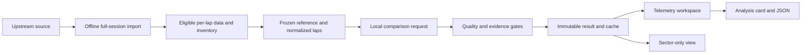

# LapDNA implementation blueprint

Revision 2 · 5 November 2026. Status: **expanded blueprint and runnable scaffold**. Real-session processing remains implementation work. The user's reference image defines the visual direction: stacked synchronized traces, sector dividers, a local-performance strip, turn numbers, and a cumulative delta.

## The product

Choose any two different drivers from an imported qualifying session, choose each driver's Q1/Q2/Q3 phase independently, and select eligible laps. The app explains where their elapsed-time difference developed and which supported telemetry patterns accompany it. Same-phase selection is the default; cross-phase comparisons require explicit opt-in and persistent context warnings.

All imported drivers appear in the roster. An eliminated driver's absent phase is unavailable with an explanation. No four-driver shortlist or six-pair restriction remains. The three starting circuits are Monza, Silverstone and Suzuka; the 2024 qualifying sessions remain candidate datasets awaiting full ingestion/eligibility/profile validation.

## Core outputs

1. Track map colored by estimated local gain.
2. Speed, throttle, gear, binary brake and cumulative delta over one distance axis, with aligned T1/T2/... labels and official sector-crossing markers.
3. An estimated local-gain strip using 100 m bins, distinct from recorded sector timing and from the corner partition.
4. Up to three supported local observations.
5. A tailored corner-speed analysis covering low, medium and high speed: included/excluded windows, independent units, coverage, gains for each driver, net contribution and limitations.
6. PNG analysis cards and evidence JSON after export implementation.

Corner classes use the frozen reference lap's reviewed apex windows, with initial project thresholds low <150 km/h, medium 150–<250 and high ≥250. They do not change when A/B are swapped. Mixed complexes and unknown classifications stay explicit. A positive net alone cannot establish that a driver is consistently faster in a class.

## Source fidelity

FastF1 is the primary ingestion target. An actual historical OpenF1 probe retrieved recorded sectors and 306 car samples for one Monza qualifying lap; this verifies availability, not a completed comparison. Source definitions and FIA per-lap sector report links are in [sources](09-sources.md).

Public channels do not include the reference image's steering trace or brake pressure. OpenF1's mini-sector arrays contain status/color codes rather than measured durations. LapDNA therefore labels its 100 m splits **estimated mini-sectors**. If only recorded sectors are available, show a sector table and separate cumulative-gap points at crossings; do not invent a continuous curve, turn attribution or corner-class analysis.

## Frozen decisions

| Concern | Decision |
| --- | --- |
| Browser | React + TypeScript + Vite |
| Charts | Apache ECharts 6.1, direct adapter, one Canvas multi-grid chart |
| Map/export | SVG reference map and dedicated card renderer |
| Backend | FastAPI + Pydantic, Python owns analytical numbers |
| Data | Whole-session offline import and per-lap normalization; cached local comparison on demand |
| Scope | Two drivers, all eligible imported laps, independent Q phases, three starting circuits |
| Alignment | Frozen session reference, integrated-speed normalized distance, nominal 5 m display grid |
| Delta | B elapsed minus A elapsed, milliseconds; positive favours A |
| Observations | Deterministic evidence templates; no runtime LLM dependency |
| Quality | pass / warn / block with raw residuals preserved |
| Contracts | Version 1.1.0; telemetry and sector-only result variants |
| Persistence | Local normalized datasets and immutable artifacts; no database in the initial release |

## Read in order

1. [Product contract](01-product.md)
2. [Architecture and renderer decision](02-architecture.md)
3. [Telemetry, mini-sector and class methodology](03-telemetry-methodology.md)
4. [Experience and screenshot translation](04-experience.md)
5. [API and contract guide](05-contracts.md)
6. [Implementation tickets](06-implementation-plan.md)
7. [Verification](07-verification.md)
8. [Operations](08-operations.md)
9. [Sources](09-sources.md)
10. [Current handoff](10-handoff.md)
11. [Implementing with GPT-6.1 Sol](11-implementation-workflow.md)
12. [Hosted preview and limitations](12-hosting.md)

Python models govern field names; methodology governs numerical meaning; tickets govern current status. Resolve contradictions in one small documented change before dependent implementation.

## Flow

## What exists now

The scaffold has a typed local API, complete-inventory selection contracts, cached comparison lookup, telemetry/sector-only schemas, turn/minisector/class fields, and a synthetic design preview of the chart layout. The preview uses a fictional six-turn loop with Sample A/B and cannot be mistaken for real F1 results. It provides turn selection, a shared distance cursor and discrete sector-only presentation. Production analysis, real track geometry, source import, URL persistence and export remain ticketed work.

## Delivery sequence

Ten working days remains a stretch target for the expanded scope. First finish one real session end to end, then extend the same engine to the other two circuits. Do not replace complete driver selection or evidence checks with a hard-coded showcase.

Days 1–2: full-session import and lap inventory. Days 3–4: reference, alignment and reconciliation. Day 5: local comparison engine, mini-sectors and class evidence. Days 6–7: production chart/map integration. Day 8: tailored analysis and exports. Days 9–10: three-circuit acceptance and release. Preserve buffer for upstream access and numerical issues. Clustering remains deferred.
