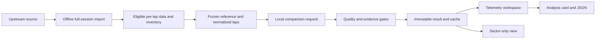

# LapDNA implementation blueprint

Revision 6 · 8 November 2026. Status: **recorded qualifying results and the real Monza 2024 lap/telemetry pilot are implemented locally; final hosted pilot verification is pending**. R01 covers classifications across 1950–2026. The [pilot guide](19-monza-2024-pilot.md) records the implemented source/comparison pipeline. The [approved design and rollout](17-approved-ui-and-telemetry-rollout.md) selects the sports-editorial landing and G1 overlays, now extended with persistent blue dark/off-white light modes. Broader telemetry remains limited to verified sessions/channels in **2018–2026**; earlier years retain timing comparisons.

## The product

Start with the current year, choose a race from that year's sourced calendar, then enter its telemetry studio. Historical calendar coverage is broader than telemetry coverage. A scheduled qualifying start does not prove session completion or imported data availability.

Choose any two different drivers from an imported qualifying session, choose each driver's Q1/Q2/Q3 phase independently, and select eligible laps. The app explains where their elapsed-time difference developed and which supported telemetry patterns accompany it. Same-phase selection is the default; cross-phase comparisons require explicit opt-in and persistent context warnings.

All imported drivers appear in the roster. An eliminated driver's absent phase is unavailable with an explanation. No four-driver shortlist or six-pair restriction remains. Monza 2024 now has all 20 drivers and 276 actual lap records: 79 timing-eligible, of which 40 support telemetry and 39 are sector-only. All source-supported qualifying events in 2018–2026 remain the broader target, with session-level verification rather than a blanket year guarantee. Silverstone/Suzuka and other events still need ingestion and reviewed profiles. Actual SQ classifications are available in R01; native SQ/lap expansion remains separate. New or changed layouts require their own reviewed profiles.

## Core outputs

1. Track map colored by estimated local gain.
2. Speed, throttle, gear, binary brake and cumulative delta over one distance axis, with aligned T1/T2/... labels and official sector-crossing markers.
3. An estimated local-gain strip using 100 m bins, distinct from recorded sector timing and from the corner partition.
4. Up to three supported local observations.
5. A tailored corner-speed analysis covering low, medium and high speed: included/excluded windows, independent units, coverage, gains for each driver, net contribution and limitations.
6. PNG analysis cards and evidence JSON, now implemented for the pilot with exact selected-lap links.

Corner classes use the frozen reference lap's reviewed apex windows, with initial project thresholds low <150 km/h, medium 150–<250 and high ≥250. They do not change when A/B are swapped. Mixed complexes and unknown classifications stay explicit. A positive net alone cannot establish that a driver is consistently faster in a class.

## Source fidelity

The Monza pilot uses an explicit OpenF1 + pinned TracingInsights/FastF1 composite because the tested primary archive required authentication and its mirror lacked the metadata resource. Native car/position records remain OpenF1; all 276 lap identities and available lap/sector durations were matched to the archive before adopting its clocks/phases/validity flags. The original archive FastF1 version remains unknown. This is a reviewed pilot exception, not a completed direct FastF1 account adapter or a silent mixed-source series. Source definitions, clock offsets, exact hashes and FIA timing checks are in [the pilot guide](19-monza-2024-pilot.md).

The [20-source survey](13-data-source-audit.md) confirms native speed, throttle, gear and binary brake, so preserve all four features and the labelled synthetic preview. The selected public feeds do not establish a measured steering-angle or brake-pressure channel. Missing channels stay unavailable; never derive pedal or gear states from speed. FastF1's inserted zero/False defaults must retain missing-data masks. OpenF1's mini-sector arrays contain status/color codes rather than measured durations. LapDNA therefore labels its 100 m splits **estimated mini-sectors**. If only recorded sectors are available, show a sector table and separate cumulative-gap points at crossings; do not invent a continuous curve, turn attribution or corner-class analysis.

## Frozen decisions

| Concern | Decision |
| --- | --- |
| Browser | React + TypeScript + Vite |
| Charts | Apache ECharts 6.1, direct adapter, one Canvas multi-grid chart |
| Map/export | SVG reference map and dedicated card renderer |
| Backend | FastAPI + Pydantic, Python owns analytical numbers |
| Data | Whole-session offline import and per-lap normalization; bounded local comparison on demand; Monza uses the reviewed explicit composite |
| Scope | Two drivers, all eligible imported laps, independent Q/SQ phases; verified 2018–2026 telemetry, older timing only; three validation pilots then all supported layouts |
| Alignment | Frozen session reference, integrated-speed normalized distance, nominal 5 m display grid |
| Delta | B elapsed minus A elapsed, milliseconds; positive favours A |
| Observations | Deterministic evidence first; optional validated LLM narrative after the evidence engine |
| Quality | pass / warn / block with raw residuals preserved |
| Contracts | Comparison/inventory 1.3.0 with explicit composite lineage and geometry units; legacy 1.2.0 accepted; calendar/classifications 1.0.0 |
| Persistence | Compact generated single-pilot publication, immutable result identity and bounded memory cache; durable multi-revision archive remains future work |

## Read in order

1. [Product contract](01-product.md)
2. [Architecture and renderer decision](02-architecture.md)
3. [Telemetry, mini-sector and class methodology](03-telemetry-methodology.md)
4. [Experience and screenshot translation](04-experience.md)
5. [API and contract guide](05-contracts.md)
6. [Implementation tickets](06-implementation-plan.md)
7. [Verification](07-verification.md)
8. [Operations](08-operations.md)
9. [Sources](09-sources.md)
10. [Current handoff](10-handoff.md)
11. [Implementing with GPT-6.1 Sol](11-implementation-workflow.md)
12. [Hosted preview and limitations](12-hosting.md)
13. [Recurring qualifying data-source audit](13-data-source-audit.md)
14. [Analysis generation and optional LLM layer](14-analysis-generation.md)
15. [Data-point inventory and implementation rollout](15-data-points-and-rollout.md)
16. [Results-first milestone and future run-by-run selection](16-results-first-milestone.md)
17. [Approved sports-editorial UI and verified 2018–2026 telemetry rollout](17-approved-ui-and-telemetry-rollout.md)
18. [Available fields and year coverage](18-data-availability-by-year.md)
19. [Monza 2024 working pilot and source decision](19-monza-2024-pilot.md)

Python models govern field names; methodology governs numerical meaning; tickets govern current status. Resolve contradictions in one small documented change before dependent implementation.

## Flow

## What exists now

R01 provides real final classifications, event-specific teams/rosters, exact phases, timing gaps and historical formats across 1,168 qualifying and 24 SQ sessions. Monza 2024 now adds native-channel import, per-lap eligibility, a fixed independent reference, raw distance delta/reconciliation, estimated mini-sectors, performance map, class/observation evidence and themed PNG/JSON exports. Shared cursor, turn zoom and map/region selection connect the graphs. Fastest eligible timings are preserved; an explicit action chooses alternative telemetry-supported laps instead of silently substituting them. The synthetic preview remains separate. The pilot does not imply telemetry coverage for other events, run-number labels, optional RPM/DRS plots or runtime LLM calls.

## Delivery sequence

The first Monza pipeline is implemented locally. Finish current release/mobile/export verification, then validate the other two pilot circuits and expand by verified session/layout across 2018–2026. The original ten-day estimate is not a promise for nine seasons of reviewed layouts. Do not replace complete driver selection or evidence checks with a hard-coded showcase.

T11 covers other complete inventories/layouts and broader archive verification; T12 retains hosted/durable release work. A direct authenticated FastF1 adapter, retained multi-revision archive hosting and source-rights review remain distinct from the completed single-pilot composite. Clustering remains deferred.
