# LapDNA implementation blueprint

Decision baseline: 5 November 2026. Status: **planning + runnable scaffold**, not an implemented analysis engine. This document is the entry point; the numbered specifications below define the actual work.

## The outcome

A reader chooses a prepared qualifying session and two drivers, sees where their lap-time difference developed, follows the same location across a map and five telemetry panels, and exports a defensible analysis card. A useful first slice is one real, validated comparison. The release expands this to Monza, Silverstone, and Suzuka with at least four eligible drivers and all six unordered pairs per circuit in one common qualifying phase.

The baseline is deliberately curated. The app only offers comparisons that have been imported and checked. It does not download a session while a visitor waits. Candidate sessions are the 2024 Italian, British and Japanese Grand Prix qualifying sessions; suitability and upstream availability are unverified. If a candidate is wet, incomplete or inaccessible, document a replacement session at the same circuit before proceeding. Q3 is preferred, not guaranteed.

## Decisions already made

| Concern | Decision |
| --- | --- |
| Product | Analysis workspace, not live timing or driver coaching |
| Data source | FastF1, isolated behind a versioned Python adapter |
| Client | React + TypeScript + Vite; responsive single page |
| Service | FastAPI + Pydantic; read-only validated artifact delivery |
| Numerical work | Python, native channel timestamps, NumPy; no browser recomputation |
| Persistence | Ignored local cache + immutable processed artifacts; no database in MVP |
| Compute | Operator-run import/compare/publish commands, implemented in T01–T05 |
| Alignment | Frozen reference lap per session/layout, normalized speed-integrated distance, 5 m display grid |
| Delta | `elapsed_B − elapsed_A` in ms; positive favours A |
| Map | Local segment gain, not the cumulative delta curve |
| Timing | Official lap/sector fields remain authoritative; publish residuals and limitations |
| Evidence | Deterministic templates with machine-readable evidence, no text-generation service |
| Quality | pass / warn / block; missing evidence produces fewer observations |
| Sharing | PNG card + JSON evidence/provenance; versioned comparison URL |
| Deployment | One Python service + static browser bundle, prepared artifacts on persistent read-only storage |
| Git | Small checked commits, ordinary descriptive messages, pushed to `sohxmm/LapDNA` |

## Read in this order

1. [Product contract](01-product.md): scope, users, acceptance criteria.
2. [Architecture](02-architecture.md): modules, ownership, data lifecycle, release structure.
3. [Telemetry methodology](03-telemetry-methodology.md): exact transformations, thresholds, uncertainty.
4. [Experience specification](04-experience.md): components, interactions, visual language, all states.
5. [Contracts](05-contracts.md): schema conventions, endpoints, errors and generation.
6. [Implementation plan](06-implementation-plan.md): ordered tickets, file targets, checks and commits.
7. [Verification](07-verification.md): invariants, fixtures, real-session release gates.
8. [Operations](08-operations.md): setup, data preparation, deployment and publishing.
9. [Sources](09-sources.md): primary references and the boundaries of their claims.
10. [Current handoff](10-handoff.md): implemented work, current checks and next ticket.

The Python models and generated contracts are authoritative for field names. The methodology is authoritative for numerical meaning. The implementation plan governs scope. If these disagree, fix the disagreement in one small commit before implementing dependent work; do not silently choose whichever is easiest.

## System flow

```mermaid
flowchart LR
  F[FastF1 upstream] --> C[Local cached session]
  C --> E[Eligible laps and native channels]
  E --> R[Frozen reference and circuit profile]
  R --> A[Distance alignment]
  A --> Q[Timing reconciliation and quality gates]
  Q --> S[Segments and evidence]
  S --> J[Versioned comparison JSON]
  J --> API[Read-only API]
  API --> UI[Map and synchronized traces]
  UI --> X[PNG plus evidence JSON]
```

## Two-week execution strategy

Assume ten focused working days, with the remaining calendar time as buffer. This is a target, not a promise that upstream data work will fit a fixed date. The critical path is real session access → valid lap selection → defensible alignment → one honest comparison → interactive rendering → exports. If the first three steps fail, do not fill the UI with invented results.

- Days 1–2: complete T01–T02; one reproducibly imported session and clear selection report.
- Days 3–4: T03–T04; frozen geometry, alignment, timing reconciliation and quality tests.
- Day 5: T05–T06; segment evidence and selectable real comparison artifact.
- Days 6–7: T07–T08; synchronized traces and track map with keyboard access.
- Day 8: T09–T10; ranked summaries, observation details and analysis export.
- Day 9: T11; three circuits, reproducible comparisons and integration checks.
- Day 10: T12; release build, operational notes, accessibility and final QA.

Stop adding features when a release gate fails. If time is tight, defer clustering, animations, theme switching and extra sessions; keep data honesty, readable traces, reconciled timings, map interaction, evidence and export.

## What this scaffold proves

The repository structure, Python service, API contract generation, browser build and empty-data experience can be run and checked. It does **not** prove that FastF1 access works, the proposed alignment thresholds are appropriate, the three candidate sessions are suitable, or the eventual observations are valid. Those are explicit implementation gates, not assumed accomplishments.
