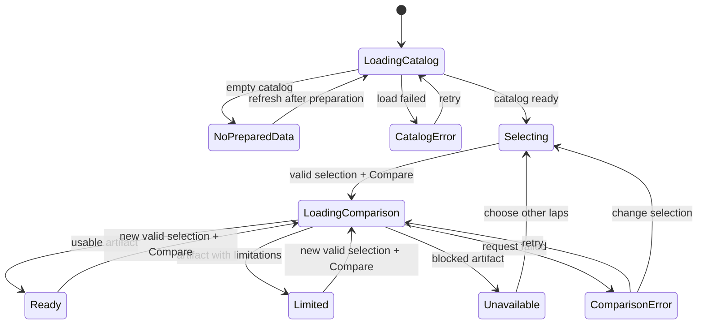

# Experience and visual specification

This document fixes the initial interaction and presentation decisions so implementation can proceed without redesign. Product scope is defined in [the product blueprint](01-product.md); numerical meaning comes from [the methodology](03-telemetry-methodology.md). Exact JSON property names come from the contracts rather than the component names below.

Implementation boundary: the current `App.tsx` is a foundation screen that requests `/api/v1/catalog`, displays its count or an honest no-data/API-error state, and offers retry/refresh. It does not yet render comparison selection, charts, observations, quality panels, or export. The full workspace below is the T06–T10 target. `/api/v1/health` reports service health; it does not establish that any source session or analysis is valid. `/api/v1/comparisons/{comparison_id}` delivers one prepared artifact after selection is implemented.

## 1. Visual direction

Build an analytical workspace: dark ink background, restrained borders, readable labels, a clear official timing summary, and generous space for the telemetry. Track geometry and charts are the main visual material. Do not add a hero photograph, animated race cars, decorative gauges, fake live indicators, or team branding to fill the scaffold.

| Token | Value | Purpose |
| --- | --- | --- |
| `--bg` | `#0B1017` | Page background |
| `--surface` | `#131C27` | Cards and chart panels |
| `--surface-raised` | `#1B2837` | Popovers and selected controls |
| `--border` | `#2A3A4D` | Quiet separators |
| `--text` | `#F1F5F9` | Primary text |
| `--muted` | `#A7B5C7` | Secondary text and axes |
| `--driver-a` | `#5ADBEA` | Driver A and regions favoring A |
| `--driver-b` | `#FFB16B` | Driver B and regions favoring B |
| `--neutral` | `#74859B` | Neutral estimated difference |
| `--warning` | `#F6D276` | Limited quality, combined with text/icon |
| `--danger` | `#FF8A94` | Unavailable or failed state, with text/icon |
| `--focus` | `#D9F7FF` | Visible keyboard focus |

Verify contrast in the implemented combinations; the palette is not a substitute for an accessibility check. Use system sans-serif fonts for interface text and system monospace/tabular numerals for timing, numeric cells, and cursor readouts. Do not depend on a remote font download.

Use a 4 px spacing base, 8 px control gaps, 16–20 px card padding, 24 px section gaps, and a maximum workspace width of 1600 px. Cards use an 8 px radius, 1 px border, and no prominent drop shadow. Interactive targets are at least 44 × 44 px; compact chart markers can have a larger invisible hit area. Body text is 14–16 px, card titles 16–18 px, page title 28–32 px. Numeric columns align on the right.

Driver colors are positional, not team colors. Always label A/B and abbreviations. A's trace is solid; B's is dashed. The difference avoids relying on color alone and remains consistent when both drivers belong to the same team.

## 2. Desktop information layout

At 1100 px and wider, render the following reading order. Header and selection controls stay in normal document flow; chart panels may have their own sticky cursor readout while the telemetry stack is in view.

```text
┌─────────────────────────────────────────────────────────────────────────────┐
│ LapDNA  /  Where did the lap time go?              Methodology   Data status │
├─────────────────────────────────────────────────────────────────────────────┤
│ Circuit / session     Q phase       Driver A       Driver B      Compare   │
│ Selected lap A details               Selected lap B details        Swap     │
├─────────────────────────────────────────────────────────────────────────────┤
│ Event • year • Q3         A  1:xx.xxx     B  1:xx.xxx    Official gap        │
│ Quality summary + detail control                   Copy link   Export card │
├─────────────────────────────────────┬───────────────────────────────────────┤
│ TRACK OVERVIEW                      │ OFFICIAL SECTORS                      │
│ Reference outline, corner labels    │       A          B        B − A       │
│ Local gain colors + visible legend  │ S1    …          …        …           │
│ Selected region / cursor marker     │ S2    …          …        …           │
│                                     │ S3    …          …        …           │
├─────────────────────────────────────┴───────────────────────────────────────┤
│ TELEMETRY      [Full lap] [Selected region]        Cursor readout / reset   │
│ Delta B−A       ─────── ±0 reference ────────────────────────────────────── │
│ Speed            A ──────     B - - -                                      │
│ Throttle         A ──────     B - - -                                      │
│ Gear             ┌───┐          ┌───┐                                     │
│ Brake            on / off lanes                                          │
│ Distance (m)             common domain and sector/region markers           │
├─────────────────────────────────────┬───────────────────────────────────────┤
│ WHERE THE GAP DEVELOPED             │ THREE OBSERVATIONS                    │
│ Ranked / Track order                │ Region + local estimate               │
│ Region | local gain | speed context │ Quantitative channel evidence         │
│ …                                   │ Inspect evidence                      │
├─────────────────────────────────────┴───────────────────────────────────────┤
│ Source • method version • generated date • limitations • data details      │
└─────────────────────────────────────────────────────────────────────────────┘
```

The map/sectors row is approximately 56%/44%; the region/observation row is 52%/48%. The telemetry is full width because comparison quality benefits from horizontal resolution. The official gap is visually primary; region estimates should not appear more precise or authoritative than the official result.

At 768–1099 px, keep the selector in two columns, stack the map and official sectors, and keep the telemetry full width. Below 768 px, use a single column. Driver A and B may share one row only if labels and controls do not truncate. Mobile order is selector, official summary, quality, map, telemetry, observations, region list, provenance. The region table becomes labeled cards instead of requiring horizontal page scrolling.

## 3. Scaffold presentation

Before any prepared data exists, render a useful application shell with:

- The LapDNA name and a one-line description.
- The three planned circuit names with a shared or individual “Availability pending validation” label.
- A prominent “No laps imported yet” or “No prepared comparisons yet” state. Include the exact local setup/ingestion step only once that command exists; the foundation currently explains the next milestone.
- An explanation of the intended output: map, synchronized telemetry, and evidence-backed observations.
- A visible foundation status and a link to project documentation when a real URL exists.

Do not render fake lap times, fabricated driver evidence, synthetic track outlines labeled as actual circuits, chart skeletons that appear to be indefinitely loading, or buttons suggesting that unavailable features work. Disabled actions need a nearby reason. This makes the scaffold reviewable without presenting future work as implemented behavior.

## 4. State model

Keep remote loading state separate from the interaction state of a successfully loaded comparison.



While a replacement comparison loads, retain the old comparison with its original title, a visible loading notice, and disabled export/share until the new selection resolves. If it fails, retain the old comparison and show an error associated with the pending selection; do not relabel old charts with new driver names. A monotonically increasing request token or request cancellation prevents a slow earlier response from replacing a later selection.

Interaction state for a loaded artifact:

| State | Meaning | Owner |
| --- | --- | --- |
| `cursorDistance` | One distance in the full reference domain, or absent | Comparison workspace |
| `cursorPinned` | Readout stays while pointer leaves charts | Comparison workspace |
| `selectedRegionId` | Selected region/observation interval | Comparison workspace |
| `viewport` | Full lap or a bounded distance interval | Comparison workspace |
| `regionSort` | Absolute local gain or track order | Region list |
| `qualityDetailsOpen` | Reconciliation panel visibility | Quality control |
| `exportState` | Idle, generating, complete, or failed | Export control |

Do not store a separate cursor in each chart. Driver selection is pending form state; the loaded artifact carries the authoritative rendered driver/lap identity. A comparison change resets cursor, region, zoom, and export state. Merely opening a quality panel does not reset exploration.

## 5. Component boundaries

These are responsibilities, not a demand for a file per row.

| Component | Input | Responsibility |
| --- | --- | --- |
| `AppShell` | App/catalog status | Page frame, title, navigation, initial errors |
| `ComparisonSelector` | Prepared catalog and pending selection | Session/phase/driver/lap selection and validation |
| `ComparisonWorkspace` | One validated comparison artifact | Shared distance selection, viewport, cursor, rendered identity |
| `OfficialTimingSummary` | Exact official values | Lap and sector durations, signed gap, contextual labels |
| `QualitySummary` / `QualityDetails` | Validation report | Plain summary plus raw reconciliation, check basis, and interval limitations |
| `TrackMap` | Reference geometry, regions, shared state | Local gain colors, region/cursor selection, reference label |
| `TelemetryPanel` | Shared distance grid, channel arrays, shared state | Five aligned charts, axes, masks, cursor readout |
| `RegionList` | Region metrics and shared state | Ranking, track order, keyboard/tap selection |
| `ObservationList` | Evidence-backed observations | Human-readable claims and evidence links |
| `ExportControl` / `AnalysisCard` | Same artifact and export state | Deterministic export from already validated values |
| `ProvenanceFooter` | Artifact/source/method identifiers | Source and method links, generated date, limitations |

Numeric computations belong to the Python analysis pipeline. The browser may format values, derive pixels, select the nearest grid index, and invert signs on an explicitly supported swap operation; it must not implement a second scientific analysis engine.

### Current metadata boundary

The existing model provides `comparison_id`, `schema_version`, `session`, `lap_a`, `lap_b`, `provenance`, `quality`, aligned sample arrays, `segments`, `evidence`, and `observations`. Session metadata includes year, round, session type, phase, circuit ID, and event name. Each lap includes driver identity, lap number, official lap/sector times, compound, tyre life when known, and track-status text. Current provenance includes source, FastF1/pipeline/methodology versions, reference and source snapshot hashes, generated time, source-session identity, circuit revision, and reference-lap ID. Quality includes distance normalization diagnostics; evidence includes transition intervals and native support spans.

Use those fields as supplied; do not derive lap start time from artifact generation time or call `generated_at` the source retrieval time. Source retrieval time, review status, threshold settings, corner labels and lap-start context are planned contract additions in T01–T05, with exact names in [the contract guide](05-contracts.md). Add them to Python and regenerate before dependent UI work. Omit an unavailable optional field or explain its absence, never manufacture it.

At the API boundary timing values are milliseconds, including `delta_ms` and `gain_ms`. The UI converts milliseconds to seconds only for display. `delta_ms` is the raw `channels_b.time_raw_ms − channels_a.time_raw_ms` series wherever valid. The initial model has no corrected delta array.

## 6. Chart specification

### Shared distance axis

- Domain is 0 to the reference length; label “Reference distance (m)”. This is an approximate alignment coordinate, not centimeter-accurate physical position.
- All plots use the identical left/right plot margins and horizontal scale. Tick positions and sector markers align exactly across panels.
- Desktop panel heights: delta 144 px, speed 176 px, throttle 120 px, gear 104 px, brake 88 px, excluding title and tick margins. Mobile may reduce speed to 150 px but must retain legible labels.
- Show x-axis ticks on the final panel; upper panels use matching subtle vertical grid lines. Each panel has its own unit label.
- Missing regions break the rendered path. Never connect a line over an unsupported telemetry gap.
- Sector markers use a subtle dashed line and S1/S2/S3 labels. Corner labels are sparse in the default view; selecting a region reveals its bounds and label.

### Delta

Show only the raw telemetry-derived cumulative difference, `delta_ms`, converted to seconds for display. Do not add an adjusted/sector-anchored curve or mode toggle in the MVP. The y-axis is seconds; include a zero line. A persistent subtitle reads “B − A · positive favors A”. Auto-scale symmetrically around zero to keep direction easy to read. Do not smooth values for presentation in a way that changes endpoints or local differences. Official lap/sector numbers remain separate reference values, not control points used to force the curve to match.

### Speed and throttle

Speed uses km/h and a domain containing both traces with modest padding; do not truncate away a meaningful local difference. Throttle uses 0–100%. A and B use their fixed colors and line styles. The cursor lists both values and their difference where valid. Apparent interpolation detail is not presented as new measured samples.

### Gear

Use integer y-ticks, step rendering, and the source's supported gear range. Never linearly interpolate between gears. Show neutral/unknown only when the channel actually represents it, and distinguish an unknown value from gear zero.

### Brake

Render two compact labeled state lanes, one per driver, with filled spans for on and quiet spans for off. The legend says “Brake on/off”. A gap is a hatched/empty interval labeled unavailable; it is not off. No percentage axis, pressure unit, or wording such as “braked harder” appears.

### Cursor readout

The shared readout shows distance, region, delta, and both drivers' speed/throttle/gear/brake values. Missing values are “Unavailable”. It follows the cursor on desktop without obscuring the selected chart, and uses a stable area above the chart stack on mobile. Do not announce every pointer movement through a screen reader live region.

## 7. Interaction specification

| Action | Result |
| --- | --- |
| Hover a chart | Update cursor to nearest valid distance-grid index; all charts and map reflect it |
| Leave a chart | Clear temporary cursor unless pinned |
| Click/tap chart | Set and pin cursor at nearest index |
| Focus shared distance slider | Expose an accessible numeric distance control and readout |
| Arrow keys on slider | Move one grid step; Shift+arrow moves ten steps; Home/End go to domain bounds |
| Click map region | Select region, pin cursor at its midpoint, highlight matching row and evidence |
| Hover map path | Resolve nearest reference polyline location; if multiple candidates are close, restrict to the selected region or choose the nearest point deterministically |
| Click region row | Select region and show its interval; do not automatically change the chart viewport |
| Click “Inspect evidence” | Select the observation's interval and zoom to it with fixed context padding |
| Click “Zoom to region” | View selected bounds plus 10% interval-width padding, clamped to the lap |
| Click “Full lap” | Restore the full domain and preserve the selected region |
| Press Escape | Clear pinned cursor/temporary selection; close an open popover before clearing the workspace selection |
| Click “Swap drivers” | Exchange A/B identity, colors, signed deltas, and text while preserving exact laps and physical reference data |
| Change region sort | Reorder rows only; retain selected interval and cursor |

Avoid freehand chart brushing in the MVP. A full-lap/selected-region viewport and accessible distance control cover the primary job with fewer synchronization edge cases. A future brush must use the same workspace state.

For chart focus, provide one shared slider rather than hundreds of focusable SVG points. Each chart has an accessible title and a concise description; tabular region and official-sector values provide a nonvisual alternative to interpreting strokes.

## 8. Local performance map

The path is a reference geometry with a visible start/finish marker, direction arrow, and named corner markers where they do not collide. Apply the circuit rotation consistently to path, markers, and cursor. Keep a fixed viewBox padded by 8% on all sides; never rotate individual layers independently.

Map color is discrete by validated analysis region in the MVP. Use cyan/orange with intensity buckets derived from absolute local estimated gain, and neutral gray below the methodology's display floor. Display a legend with the actual bucket boundaries used for that comparison. Unsupported spans have a dashed neutral treatment and explanatory tooltip. Do not assign a winning driver when the region fails quality checks.

An accessible region selector or linked region list duplicates every map interaction. Map labels show region name, estimated local gain, and favored driver; cumulative advantage is shown separately in the cursor readout. The map must not resemble two accurately measured racing lines.

## 9. Timing and number formatting

- Official lap time: `m:ss.sss`; official sectors: `ss.sss`.
- Official signed gap: `+0.123 s` or `−0.123 s`, preserving millisecond timing precision where sourced.
- Approximate region time contribution: usually hundredths of a second with `≈`, with the display floor controlled by the methodology. Keep exact internal values for reconciliation.
- Delta chart ticks: two decimal places unless a tighter scale needs three; an explicit telemetry estimate label remains visible.
- Speed: whole km/h in summaries; one decimal only in detailed readouts if it clarifies interpolation rather than implying source precision.
- Throttle: whole percent. Gear: integer. Brake: On, Off, or Unavailable.
- Distance: nearest whole meter in cursor display, with `≈` for inferred transition positions. Do not display submeter brake-point claims.
- Missing is an em dash plus an accessible explanation. Zero is displayed as zero. `NaN`, infinity, null strings, and placeholder zeros never reach the interface.
- Negative zero is formatted as zero. Tiny values beneath the region display floor say “Below display threshold” rather than inventing a decisive gain.

Time and distance formatting are centralized utilities. Driver abbreviations accompany signed estimates so users do not need to remember the sign convention while reading a single row.

## 10. Observations and evidence display

Observation structure:

```text
01  {Region name}                              ≈ {gain} to {driver}
{Template sentence describing the local time change.}
Evidence: {metric A} vs {metric B}; {second supported metric if available}.
{Short context/limitation when relevant.}
[Inspect evidence]
```

Use one primary observation per disjoint region/group. If the top-ranked regions overlap, the pipeline resolves them before the UI receives the observations. The UI does not rank or compose its own claims. Observations do not have fake confidence percentages or opaque “AI insight” labels. Use the quality/coverage evidence supplied by the pipeline.

On selection, show the interval bounds in the chart header and shade the same interval in all charts. Preserve the distinction between “local time gain in this region” and “total advantage at the region exit”. Evidence text must identify which quantity it uses.

An observation may describe a lower minimum speed, a speed difference on a straight, a difference in the brake-on transition estimate, or a throttle pickup pattern only when the methodology's validity rules allow that metric. Words such as “caused”, “mistake”, “optimal”, “understeer”, and “confidence” are not generated from these channels.

## 11. Error and empty-state copy

| Condition | Heading | Required action/detail |
| --- | --- | --- |
| Empty catalog | No prepared comparisons yet | Explain preparation command/workflow; planned circuits remain visibly unprepared |
| Catalog request failed | Could not load prepared sessions | Retry; preserve a useful error identifier without exposing stack traces |
| Only one eligible driver | Two eligible drivers are required | Explain phase restriction and offer another available phase/session |
| Driver has no eligible lap | No supported lap in this phase | Show exclusion reason summary; choose another driver or phase |
| Pair/lap artifact absent | This pair has not been prepared | Offer published pairs/laps from the catalog; do not start live scientific processing |
| Same driver in both slots | Choose two different drivers | Inline validation; Compare disabled |
| Unsupported URL | This comparison is not available | Return to prepared catalog; never silently substitute another comparison |
| Comparison request failed | Could not load this comparison | Retry while retaining the previous comparison identity if present |
| Timing reconciliation failed | Regional analysis is unavailable | Block catalog promotion; keep official times/reason in operator report; defensively suppress narrative/export if a blocked artifact is loaded |
| Missing brake channel | Brake data unavailable | Keep other valid channels; suppress brake-specific evidence |
| Telemetry gap | Data unavailable in this interval | Break paths, mark affected regions, disclose limitation |
| Too few observations | Fewer supported observations | Show only valid observations and explain why |
| Export failed | Could not create the card | Keep the analysis intact; retry or download JSON |
| Clipboard unavailable | Link could not be copied | Show selectable URL text in a focused field |

Error messages should name the user's next available action. Network details and diagnostic traces belong in logs, not in the normal interface. An upstream data absence is different from an application crash.

## 12. Quality details panel

Use an expandable section adjacent to the quality summary, not a modal required to understand the lap. It includes:

1. Overall status and machine-readable reason codes translated to plain language.
2. For each driver: eligibility status, sample coverage, missing channels, and major telemetry gaps.
3. Official lap/sector values alongside the raw estimates and residuals used for validation, including each check's `timing_constraint`, `calibration`, or `cross_lap_consistency` basis.
4. Distance normalization scale factors and methodology version supplied by the current contract. No timing-correction result or adjusted curve is implied; raw timing remains unchanged.
5. Regions excluded from analysis and why.
6. Reference lap, circuit revision, artifact generation time, and methodology/pipeline/schema versions in a compact technical details subsection. Add source retrieval time and grid settings when the ingestion contract supplies them; keep the timestamps distinct.

Status uses the exact `pass | warn | block` values and methodology thresholds. Display labels are “Data checks passed”, “Limited”, and “Unavailable”. The browser must not choose looser thresholds to display a more favorable badge. Reconciliation data remains available in JSON exports even if the card shows only a compact summary.

## 13. Export card layout

Render an explicit `AnalysisCard` composition independent of the scroll position and current zoom, using the loaded artifact's full-lap summary. Output size is 1080 × 1350 px with 48 px outer padding, the same palette, and no interactive controls.

| Vertical area | Approximate allocation | Content |
| --- | --- | --- |
| Header | 150 px | Brand, event/year/phase, exact selected laps |
| Official summary | 130 px | Both official times, gap, sectors |
| Track and delta | 420 px | Map, local-gain legend, compact cumulative delta |
| Observations | 430 px | Up to three compact evidence blocks |
| Provenance/footer | 124 px | Quality, source, method/artifact version, limitations |

The allocation is a design starting point; test rendered output rather than assuming the arithmetic prevents overflow. Use at least 24 px body text in the exported image. The source label and limitations stay legible at half size. Font loading, SVG rasterization, clipping, and missing-channel scenarios must be checked before calling export complete.

The card always includes “Regional estimates are approximate. Brake telemetry is on/off.” with source attribution. Any significant limitation on the loaded comparison appears on the card as well. A blocked comparison cannot produce a normal-looking analysis card.

## 14. Frontend acceptance checklist

- An empty repository data directory produces an honest no-data screen, not fabricated content.
- Choosing a new pair cannot leave old values under new names, even when responses arrive out of order.
- Swapping A/B reverses signs and favored-driver labels without changing physical region locations or selected laps.
- A single cursor location updates all charts, map location, and readout consistently.
- Clicking an observation selects exactly its evidence interval.
- Delta and map legends describe different quantities correctly: cumulative difference versus local contribution.
- Gear uses steps; brake is binary; unknown data is not drawn as zero/off.
- A keyboard user can select laps, inspect regions and evidence, move the cursor, reset zoom, read quality details, and export.
- At 390 px width there is no page-level horizontal overflow, clipped primary action, unreadable axis label, or inaccessible region value.
- At 200% zoom the selection controls and summary remain usable.
- A reduced-motion preference disables nonessential animation; no motion is required to interpret data.
- Exported values match the loaded artifact and the card carries the same material limitations.
- Real session names and lap times appear only after source-backed artifacts are prepared and validated.
